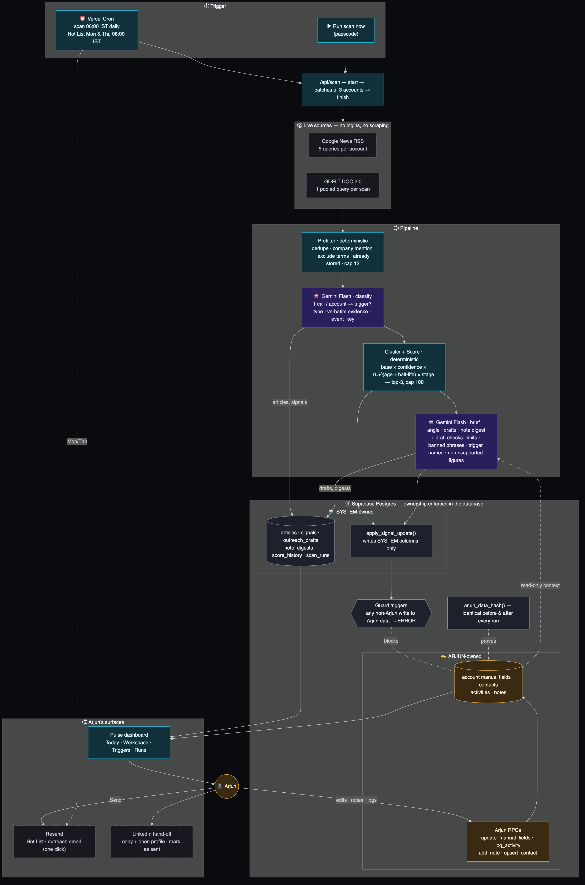

# Pulse — Components Map

**Printable swimlane map (PDF):** [`docs/Pulse-Components-Map.pdf`](docs/Pulse-Components-Map.pdf) · source [`docs/component-map.html`](docs/component-map.html)

Live version: [`/how-it-works`](https://pulse-ten-drab.vercel.app/how-it-works) · Source: [`docs/components-map.mmd`](docs/components-map.mmd) (generated from `src/lib/components-map.ts`).

## Legend

| Colour | Meaning |
|---|---|
| 🟪 Violet | **AI** — Gemini Flash (`@google/genai`, structured JSON + zod) |
| 🟦 Cyan | **Deterministic** code (no AI) |
| ⬜ Grey | **SYSTEM-owned** data and the pipeline's single write path |
| 🟨 Amber | **ARJUN-owned** data and Arjun's write path |
| ⬛ Dashed | External service |

## Flow

1. **Trigger** — Vercel Cron (daily scan 06:00 IST; Hot List Mon & Thu 08:00 IST) or *Run scan now* (passcode).
2. **Scan API** — `/api/scan` runs `start → batches of 3 accounts → finish` so every invocation stays inside Vercel's time limit.
3. **Sources** — Google News RSS (5 queries per account) + one pooled GDELT DOC 2.0 query per scan. No logins, no LinkedIn scraping.
4. **Prefilter** *(deterministic)* — URL normalisation, near-duplicate titles, company/alias mention, `exclude_terms`, already-stored URLs, cap of 12 per account (20 on the first-ever scan, 30-day backfill).
5. **Classify** *(Gemini Flash, 1 call / account)* — about-this-company? trigger? type, verbatim evidence (verified in code), confidence, `event_key`.
6. **Cluster + Score** *(deterministic)* — same type + 3 days + same `event_key` = one event; corroboration +0.1 confidence; `base × confidence × 0.5^(age/half-life) × stage`; warmth = top-3, cap 100.
7. **Brief / angle / drafts / note digest** *(Gemini Flash)* — Arjun's notes and history are **read-only** context. Drafts pass deterministic checks (channel limits, banned phrases, trigger named, every figure present in the source facts) or are regenerated once and flagged.
8. **Write-back** — SYSTEM tables directly; `accounts` **only** via `apply_signal_update()`.
9. **Surfaces** — dashboard, Resend (Hot List + one-click outreach email, SAFE_MODE), LinkedIn hand-off (copy + open profile + mark as sent).

## Who owns what

| ✍️ ARJUN (only Arjun's RPCs may write) | 🤖 SYSTEM (only the pipeline writes) |
|---|---|
| `accounts`: company details, stage, search aliases / exclude terms, `last_contact_date`, `arjun_notes`, `relationship_read`, `next_step`, `next_step_due`, `do_not_contact_until` | `accounts`: warmth score/tier/trend, score breakdown, top signal, signal summary, why-now, angle, brief, recommended contact, signal counts, scan times |
| `contacts`, `activities` (append-only), `notes` | `articles`, `signals`, `outreach_drafts`, `note_digests`, `score_history`, `scan_runs`, `email_runs` |

Enforced in Postgres (`supabase/migrations/0002_ownership.sql`): guard triggers raise `OWNERSHIP_VIOLATION` on any write to Arjun's columns/tables unless `app.actor = 'arjun'` (set only inside Arjun's RPCs). `arjun_data_hash()` is recorded before and after every scan.
