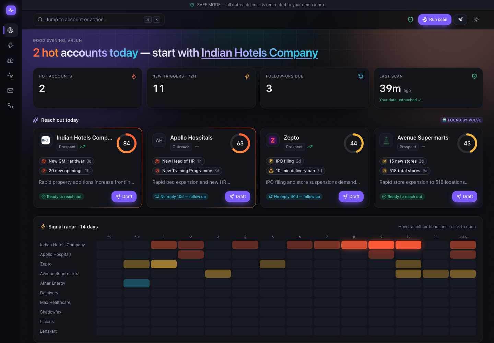
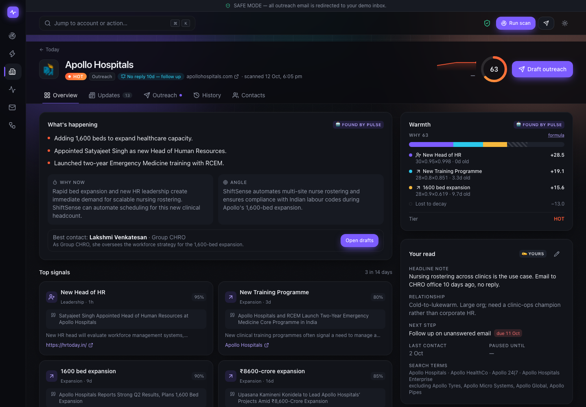
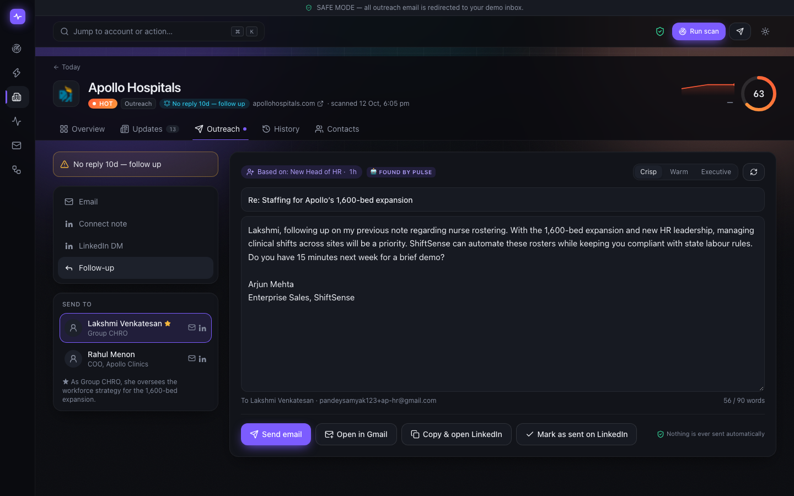
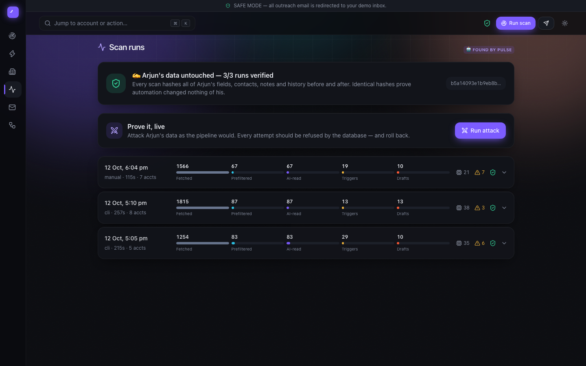
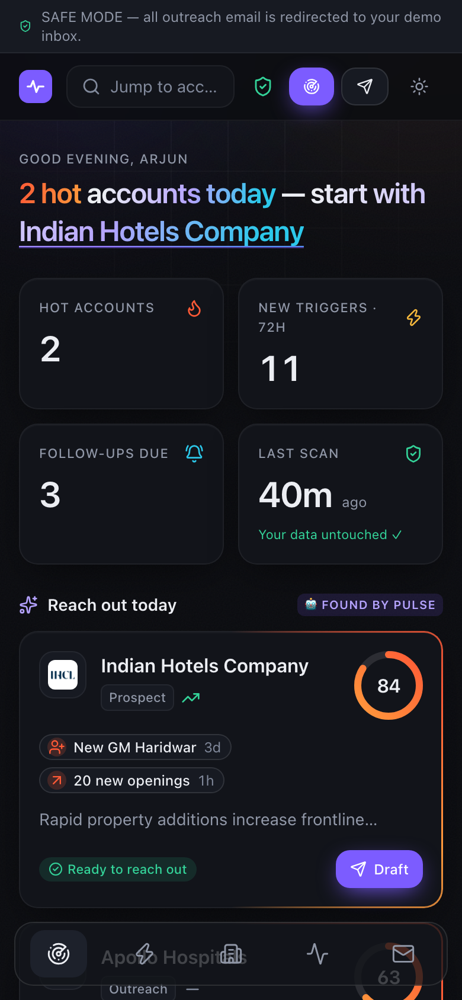

# Pulse — account signals & outreach workspace

**Live:** https://pulse-ten-drab.vercel.app · fully open, no passcode (`SAFE_MODE` keeps outreach email in the demo inbox) · [Components Map](COMPONENTS_MAP.md)

Arjun sells a workforce-management SaaS (fictional "ShiftSense") to Indian mid-market and enterprise companies. Pulse tells him **in five seconds who to contact today and why**: it reads live news about every account, detects workforce triggers, scores warmth with a transparent formula, drafts outreach tied to the trigger, and emails him a Hot List every Monday and Thursday — **without ever overwriting his own notes, history or fields.**



<p align="center">
  
  
</p>
<p align="center">
  
  
</p>

---

## What it does

| | |
|---|---|
| 📰 **Reads** | Google News RSS (5 queries/account) + GDELT DOC 2.0, every morning. Keeps a per-company feed with AI one-liners. |
| ⚡ **Detects** | Gemini Flash classifies each item: leadership hire, headcount expansion, funding, workforce digitalisation, operational pain, new market, M&A — with verbatim evidence. |
| 🎯 **Scores** | Deterministic, explainable warmth (0–100). Old signals decay, so quiet accounts sink on their own. Click any ring to see exactly why. |
| ✉️ **Drafts** | Email, LinkedIn connection note (≤280 chars), DM and follow-up — opening with the trigger, for the recommended contact, aware of what Arjun already said. Tone: crisp / warm / executive. |
| 🚀 **Sends** | One explicit click (confirmation modal) via Resend, or *Open in Gmail*. LinkedIn: copy + open profile, then *Mark as sent*. Nothing is ever sent automatically. |
| 🗂 **Remembers** | Unified timeline of activities and notes, one-line activity logging, "Reply received?" quick actions, and an AI digest of open loops — stored separately from his notes. |
| 📬 **Hot List** | Mon & Thu 08:00 IST: top 10 accounts by signals in the last 72 h, each with a one-line summary, angle, source and deep link; plus *Follow-ups due* and *Gone quiet*. |

Screens: **Today** (KPI tiles, reach-out cards, 14-day signal heat grid, ranked table with J/K navigation and quick-look drawer) · **Account workspace** (Overview, Updates, Outreach, History, Contacts) · **Triggers** · **Runs** (funnel, Gemini calls, errors, integrity hashes) · **Hot List emails** · **How it works**. ⌘K command palette, dark/light, mobile layout.

## The data-ownership guarantee

Every column and table has exactly one owner. Four layers enforce it (`supabase/migrations/0002_ownership.sql`):

1. **Single write path for automation.** The pipeline touches `accounts` only through `apply_signal_update()` (`SECURITY DEFINER`, sets `app.actor='system'`), which writes SYSTEM columns and ignores everything else.
2. **Guard triggers.** Any change to Arjun's columns, or any insert/update/delete on `contacts`, `activities`, `notes`, raises `OWNERSHIP_VIOLATION` unless `app.actor='arjun'`. This is stricter than "block the system actor": a raw service-role `.update()` with no actor is blocked too. Activities are append-only (only outcome/note can change).
3. **Arjun's write path.** UI edits go through `update_manual_fields`, `log_activity`, `add_note`, `upsert_contact` (server actions). `log_activity` also moves `last_contact_date` — Arjun's own action.
4. **Proof.** `arjun_data_hash()` (md5 over all Arjun data) is stored before/after every scan in `scan_runs` and shown as the 🛡 shield. `npm run test:integrity` runs the full pipeline, sends a hostile payload through the system write path, asserts identical hashes, and asserts that system/no-actor writes to `arjun_notes`, `last_contact_date`, activities, notes and contacts all throw.

```
$ npm run test:integrity
  ✓ ARJUN data hash unchanged after automation
  ✓ system actor editing arjun_notes throws  — OWNERSHIP_VIOLATION: actor system attempted to modify ARJUN columns on accounts
  ✓ system actor inserting an activity throws — OWNERSHIP_VIOLATION: actor system attempted INSERT on ARJUN table activities
  ✓ raw service-role update of arjun_notes throws — OWNERSHIP_VIOLATION: actor none …
  … 11/11 passed
```

**Prove it live:** the Runs page has a **Run attack** button. It tries 7 forbidden writes against Arjun's data — as the pipeline, with no actor, and as a raw admin UPDATE that skips every RPC — inside a transaction that always rolls back, then shows each one `BLOCKED` and the hash before = after.

RLS is on for every table: the browser's anon key can only `SELECT`; every RPC is revoked from `anon`/`authenticated`.

## Scoring

```
signal_score = base_weight × confidence × 0.5^(age_days / half_life_days) × stage_multiplier
warmth_score = min(100, sum of top-3 event scores)          hot ≥ 60 · warm ≥ 35 · cool ≥ 15 · quiet
```

| Signal | Base | Half-life |
|---|---|---|
| Leadership hire (CHRO / CPO / VP Ops / COO) | 30 | 21 d |
| Headcount expansion (hiring, new stores / hubs / hotels / hospitals) | 28 | 14 d |
| Funding round | 25 | 30 d |
| Workforce digitalisation | 22 | 21 d |
| Operational challenge | 20 | 10 d |
| New geographic market | 18 | 14 d |
| M&A / restructuring | 15 | 21 d |

- **Clustering:** Gemini assigns an `event_key` per real-world event; same type + within 3 days + same key = one event. Only the best item scores; each extra source adds +0.1 confidence (cap 1.0).
- **Stage multipliers:** customers ×1.3 on expansion (upsell); prospects ×1.2 on leadership hires (a new buyer).
- **Departures** (e.g. a COO resigning) count as leadership change but are capped at 0.6 confidence — a vacancy, not yet a buyer.
- **Readiness** ("Contacted 3d ago — wait", "Paused until 5 Jan", "No reply 10d — follow up") is shown alongside warmth and never changes the score.

## AI (Gemini Flash only)

All AI uses Gemini Flash through `@google/genai` with `responseMimeType: application/json` + a JSON schema, validated with **zod**; invalid output is retried once, then logged and skipped. 429/503 back off per model.

- **Classify** — 1 call per account per scan (only for new, prefiltered items).
- **Brief + angle + drafts** — 1 call per account with a fresh trigger, only when the top signal changed; brief-only otherwise.
- **Note digest** — only when Arjun's notes/activities changed (source hash).
- **Anti-hallucination gate on drafts** — channel limits, banned phrases (incl. flattery, "now that your…", "we have helped…"), the trigger must be named, and **every figure in a draft must appear in the source facts**. Failures regenerate once and stay visibly flagged.

**Free-tier note.** The Gemini key is on the free tier (~5 requests/min and a small daily cap *per model*). Calls are spread over a pool of Flash models (`gemini-flash-latest` → `gemini-3.7-flash` → `3.6` → `3.5` → `3-flash-preview`; Flash-Lite deliberately excluded) with a per-model rate limiter; the model used for each call is recorded on `/runs`.

## Sources and the LinkedIn decision

- **Google News RSS** (primary) and **GDELT DOC 2.0** (one pooled query per scan, best-effort — GDELT rate-limits aggressively).
- **LinkedIn is never scraped or automated.** LinkedIn's terms forbid automated access and messaging, and automation risks getting Arjun's account banned. Executive moves are caught through news queries (`appoints OR joins OR names … CHRO OR COO …`). Pulse drafts the message within LinkedIn's limits, copies it and opens the profile; Arjun sends it and clicks *Mark as sent*, which logs the activity.

## Classifier eval

`eval/labelled_headlines.json` — 33 real headlines fetched by Pulse, hand-labelled against the written rules (11 triggers, 15 non-triggers, 7 wrong-company such as *Apollo Tyres*, *Max Life*, *Max Estates*). Borderline labels are marked `review`. `npm run eval` prints precision, recall, wrong-company rejection and type accuracy, and writes `eval/results.json`.

> **Results:** _pending — the eval run is scheduled after the Gemini free-tier quota resets; numbers will be pasted here from `eval/results.json`._

## Seed data

Ten real Indian frontline-heavy companies (Zepto, Delhivery, Lenskart, Apollo Hospitals, IHCL, Shadowfax, DMart, Licious, Ather Energy, Max Healthcare) with **fictional** manual fields, contacts, activities and notes. Scenarios: Ather paused until January, Shadowfax contacted 3 days ago, Lenskart customer with an expansion conversation, Apollo with an unanswered email from 10 days ago. Contact emails are plus-addresses of `DEMO_CONTACT_EMAIL`; `SAFE_MODE=true` redirects every outreach email there. LinkedIn URLs are editable placeholders (a LinkedIn people search).

## Setup

```bash
npm install
cp .env.example .env.local      # fill in values
# apply supabase/migrations/*.sql in order (Supabase SQL editor or CLI)
npm run seed                    # 10 accounts + contacts, activities, notes
npm run scan                    # live fetch → classify → score → drafts
npm run test:integrity          # full pipeline + ownership proofs (--quick skips the live pipeline)
npm run eval                    # classifier precision / recall
npm run dev
```

| Env var | Purpose |
|---|---|
| `GEMINI_API_KEY`, `GEMINI_MODEL`, `GEMINI_FALLBACK_MODELS`, `GEMINI_RPM` | Gemini Flash + model pool / rate limit |
| `NEXT_PUBLIC_SUPABASE_URL`, `NEXT_PUBLIC_SUPABASE_ANON_KEY` | Read-only browser/server reads (RLS) |
| `SUPABASE_SERVICE_ROLE_KEY` | Server-only: pipeline + RPC calls |
| `RESEND_API_KEY`, `OUTREACH_FROM_EMAIL` | Email delivery |
| `HOTLIST_TO_EMAIL`, `ARJUN_REPLY_TO` | Hot List recipient, reply-to on outreach |
| `DEMO_CONTACT_EMAIL`, `SAFE_MODE` | Demo inbox; redirect all outreach (default on) |
| `CRON_SECRET` | `Authorization: Bearer` for `/api/cron/*` |
| `REQUIRE_PASSCODE`, `APP_PASSCODE` | Optional: set `REQUIRE_PASSCODE=true` to lock write actions behind `APP_PASSCODE` (read-only demo otherwise). Off by default. |
| `NEXT_PUBLIC_APP_URL` | Deep links in the Hot List |

**Crons** (`vercel.json`, UTC): scan `30 7 * * *` (13:00 IST — just after the Gemini free-tier daily quota resets at 12:30 IST), Hot List `30 2 * * 1,4` (Mon/Thu 08:00 IST; runs a fresh scan first if the last one is > 6 h old). Cron scans work in batches within a time budget; deferred accounts are logged and picked up next run.

## Quality

- **Unit tests** (`npm test`, Vitest) for the deterministic core: decay maths, top-3 cap, stage multipliers, event clustering, first-report ageing, prefilter (word-boundary matching, exclude terms, dedupe, priority), draft gate (the real hallucinations we caught), readiness.
- **CI** (`.github/workflows/ci.yml`): lint + typecheck + tests on every push.
- **Accessibility:** Lighthouse **100 accessibility · 100 best practices** on every page (Today, account workspace, Triggers, Accounts, Runs, Emails, How it works). Full keyboard support (⌘K, J/K, D, L, N, 1–5) and `prefers-reduced-motion` respected everywhere.
- **Guards for the open app:** one scan per 10 min, 4 regenerations per account per hour, 10 sends per hour — all enforced from database state so they hold across serverless instances. Abandoned scans are closed automatically with their integrity hash recorded.
- **Robust rendering:** entrance animations are pure CSS, so content is visible from the server HTML before JavaScript loads; skeleton loaders, error and 404 pages.

## Stack

Next.js 15 (App Router, TypeScript) · Tailwind v4 · Framer Motion · cmdk · sonner · lucide · Mermaid · Supabase Postgres · Gemini Flash (`@google/genai`) · Resend · Vercel (Cron, Tokyo region next to the database).

## Known limitations (honest list)

- Gemini free tier: a heavy day of manual regenerations can exhaust the daily quota; scans then record per-account errors and the next run catches up. Adding billing to the key removes this.
- GDELT frequently returns 429 from shared IPs; Google News carries the load.
- Company logos come from Google's favicon service with an initials fallback (Clearbit's logo API is retired).
- Resend without a verified domain can only deliver to the Resend account owner — fine for SAFE_MODE demos; production outreach needs a verified sending domain.
